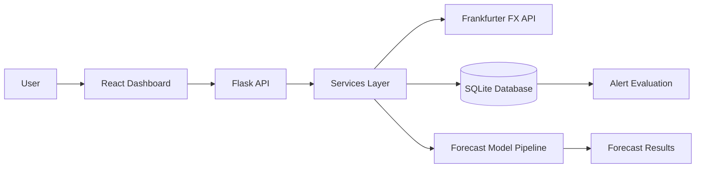
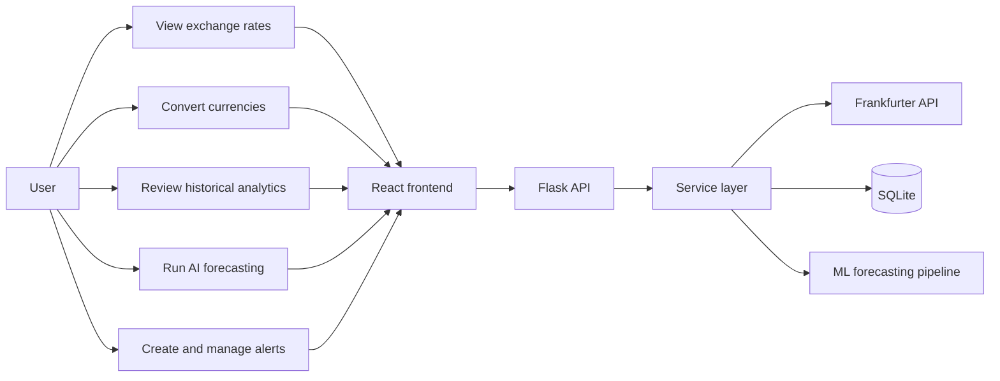
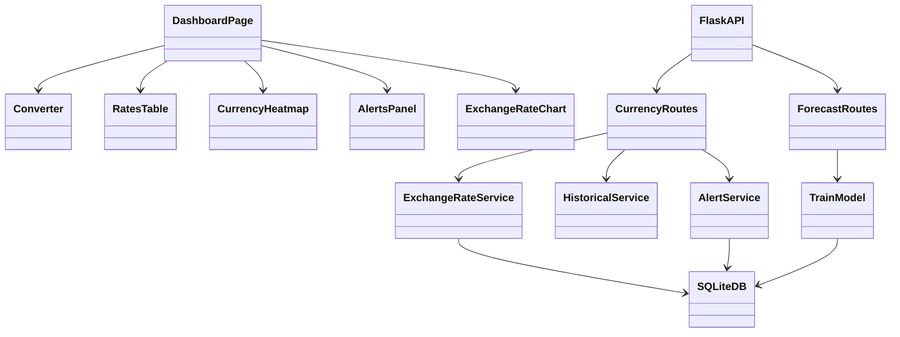
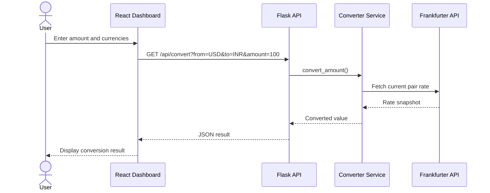
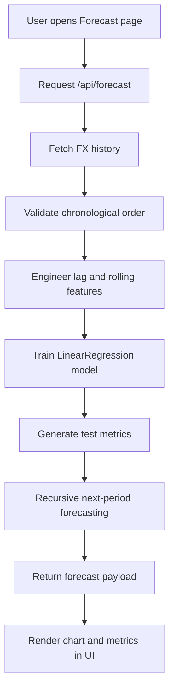

# Architecture Documentation

## High-level system design

## Layer description

### Presentation layer
The React frontend is a single-page dashboard with navigation sections for overview, rates, analytics, forecasting, and alerts.

### Application layer
Flask routes validate inputs, orchestrate calls to the service layer, and return JSON responses to the frontend.

### Data layer
SQLite stores exchange-rate snapshots, alert configuration, alert history, and forecast metadata. This supports persistent alert tracking and local auditability.

### ML layer
The forecasting service prepares time-series features, trains a linear regression model with chronological splitting, and produces prediction values with evaluation metrics.

## Design principles

- separation of concerns,
- stateless external API integration,
- modular service access,
- real-time dashboard responsiveness,
- maintainability through clear blueprint boundaries.

## Scalability note

The current solution is ideal for a local educational deployment. The architecture can be extended with caching, load balancing, and a production-grade database if the application is expanded for production use.

## UML Diagrams

### Use case diagram

### Component diagram

### Sequence diagram for conversion

### Activity diagram for forecasting workflow

